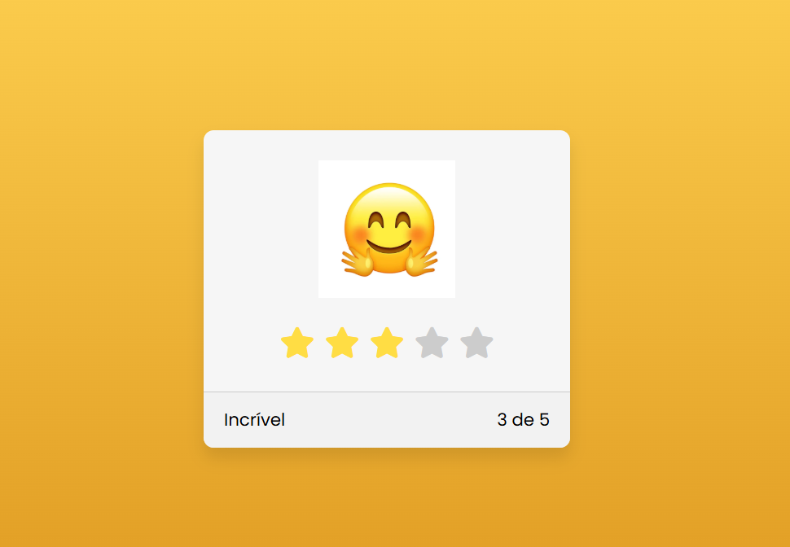

# ⭐ Página de Avaliação Interativa

Projeto de uma página de avaliação interativa com sistema de classificação por estrelas, desenvolvido com **HTML5 e CSS3** como parte de uma atividade prática do curso PROA.

O projeto tem como objetivo explorar a criação de componentes interativos para interfaces web, trabalhando com seletores CSS, campos de seleção, transições visuais e atualização dinâmica de elementos conforme a avaliação escolhida pelo usuário.

## 🖥️ Prévia do projeto

  

🔗 **[Acesse o projeto online](https://gabrielc0liveira.github.io/Projeto23Proa-PaginadeAvaliacao/)**

## Funcionalidades e características

- Sistema interativo de avaliação de 1 a 5 estrelas.
- Seleção de notas utilizando botões do tipo radio personalizados.
- Destaque visual das estrelas conforme a avaliação selecionada.
- Alteração automática do emoji de acordo com a nota escolhida.
- Exibição de mensagens personalizadas para cada avaliação.
- Atualização dinâmica da pontuação selecionada.
- Animação de transição entre os emojis.
- Interface visual com cartão centralizado e bordas arredondadas.
- Fundo com efeito degradê em tons de amarelo e laranja.
- Utilização de ícones de estrelas da biblioteca Font Awesome.
- Interatividade desenvolvida exclusivamente com HTML e CSS, sem JavaScript.

## Tecnologias utilizadas

- **HTML5:** estruturação da página, criação dos campos de avaliação e organização dos elementos visuais.
- **CSS3:** estilização, transições, seletores avançados, personalização das estrelas e atualização visual das avaliações.
- **Font Awesome:** utilização dos ícones de estrelas para o sistema de classificação.
- **Google Fonts:** utilização da fonte Poppins.

## Aprendizados

Durante o desenvolvimento, foram praticados conceitos como:

- Estruturação de componentes interativos utilizando HTML.
- Criação de sistemas de avaliação com `input type="radio"`.
- Associação de elementos utilizando os atributos `id` e `for`.
- Personalização visual de campos de seleção com CSS.
- Utilização da pseudoclasse `:checked` para identificar opções selecionadas.
- Aplicação da pseudoclasse `:hover` para criar efeitos visuais.
- Utilização do combinador de irmãos `~` para modificar elementos relacionados.
- Aplicação de seletores CSS para controlar diferentes estados da interface.
- Criação de conteúdos dinâmicos com os pseudoelementos `::before`.
- Utilização da propriedade `content` para alterar textos conforme a avaliação.
- Criação de animações suaves utilizando `transition`.
- Movimentação de imagens por meio da propriedade `margin-top`.
- Controle da exibição de elementos com `overflow: hidden`.
- Organização e centralização de elementos utilizando Flexbox.
- Aplicação de gradientes com `linear-gradient()`.
- Estilização de cartões utilizando `border-radius` e `box-shadow`.
- Integração de bibliotecas externas de ícones.
- Desenvolvimento de interatividade utilizando exclusivamente HTML e CSS.

## 📂 Como executar o projeto

🔗 **[Acesse o projeto online](https://gabrielc0liveira.github.io/Projeto23Proa-PaginadeAvaliacao/)**

---

Desenvolvido por **Gabriel Oliveira** como parte das atividades práticas do PROA.
